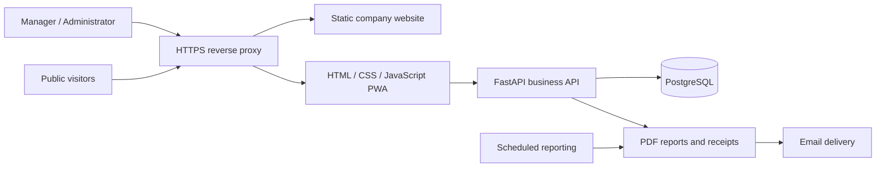

# NEO BRICKS
### Factory operations platform & company website

**A production application shaped by day-to-day client feedback.**

Python · FastAPI · PostgreSQL · JavaScript · PWA · React · TypeScript

[Public company website](https://neobrickskerala.com/) · [Architecture](docs/ARCHITECTURE.md) · [Case study](docs/CASE_STUDY.md)

---

## Overview

NEO BRICKS brings production, material inventory, sales, customer accounts and cost reporting into one application for a fly ash brick manufacturer. A separate public website presents the company and its products.

The platform provides distinct manager and administrator workflows. Its interface has evolved through client use: quicker daily entries, readable stock ledgers, clearer bills, and profit calculations that account for inventory carried between months.

**Developed by [zac-tec](https://github.com/zac-tec).** This repository is a public portfolio and technical case study. Production source, business records, credentials and operating instructions are maintained privately. There is no public dashboard login or demo account.

## Main capabilities

| Area | Delivered functionality |
|---|---|
| Production | Dated entries, material consumption, labour recording and cost history |
| Inventory | Material balances, audited adjustments, batch-based brick stock and damage tracking |
| Quantity ledger | Year/month navigation with daily opening, movements and closing balances |
| Sales | Variable brick prices, GST and optional transportation breakdowns |
| Customers | Searchable directory, purchase/payment history, balances and weighted average rates |
| Receipts | PDF preview, useful download filenames and sharing on supported devices |
| Utility bills | Monthly electricity and two-month water allocation by production mixes |
| Profit analysis | Brick revenue excluding GST/transport, production-month costs and editable scenarios |
| Reporting | PDF reports and scheduled email delivery |
| Mobile experience | Responsive layouts, installable PWA and navigation adapted to daily use |

## Architecture at a glance

The operations frontend uses plain JavaScript with focused feature modules. FastAPI handles validation, permissions and business rules; PostgreSQL stores operational records. The public website uses React, TypeScript and Vite. The deployment uses Nginx, systemd and HTTPS.

## Selected engineering decisions

- **Explainable calculations:** concise line items expose how totals are formed, with incomplete costs identified rather than silently guessed.
- **Inventory-aware profit:** sold bricks use their production months' costs, including carried inventory; fixed charges are not counted twice.
- **Audited corrections:** stock adjustments record their reason and resulting balance, with checks against stale edits.
- **Historical consistency:** dated rates and saved cost snapshots preserve context when settings change.
- **Useful mobile workflows:** compact summaries, customer drilldowns and readable ledgers reduce unnecessary navigation.
- **Recovery beyond Git:** encrypted off-server backups and isolated restore checks complement private source control.

## Delivery scope

Business workflow design, database modelling, backend and frontend implementation, PDF/email reporting, public website development, server migration and continued client-driven improvements.

The application was migrated from Raspberry Pi hosting to a VPS. Public website and authenticated operations workflows are deployed separately, allowing focused updates.

## Portfolio boundaries

This showcase contains documentation only. No real customer names, invoices, financial totals, server addresses, access keys or database exports are included. Application availability and backup status are operational matters, not guarantees made by this portfolio.

PWA installation supports an app-like experience; business transactions require the server connection. Profit outputs are estimates based on recorded data and identified assumptions.

Client branding remains associated with NEO BRICKS. This repository does not grant rights to reuse the client's identity or private application.
