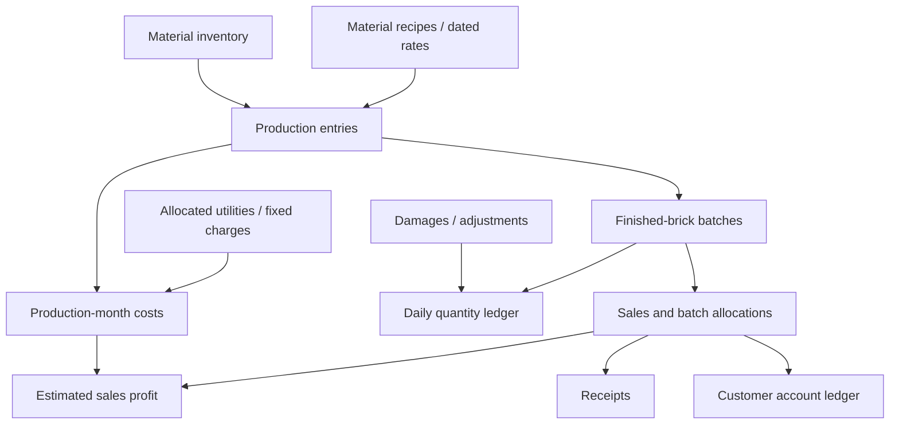

# Architecture

## Components

| Layer | Technology | Responsibility |
|---|---|---|
| Operations interface | HTML, CSS, JavaScript | Manager/admin workflows and mobile navigation |
| Installable shell | Web app manifest, service worker | PWA presentation and versioned static assets |
| Business API | Python, FastAPI, Uvicorn | Validation, authentication, authorization and business rules |
| Storage | PostgreSQL | Production, stock, sales, customer ledger and configuration |
| Documents | Server-generated PDF, local PDF.js preview | Reports, receipts and browser preview |
| Reporting | Scheduler and Resend | Scheduled outbound reports |
| Public website | React, TypeScript, Vite | Company information and product presentation |
| Hosting | Linux, Nginx, systemd, HTTPS | Routing and application lifecycle |

## Business flow

## Calculation boundaries

Sales distinguish the brick value from GST and transportation. Profit reporting uses brick revenue before tax and transport, then deducts the costs associated with the production months of the sold stock. Unit costs include relevant production and fixed charges; these are not deducted again. Missing cost information remains explicit.

Hypothetical quantity/rate changes are calculator scenarios, not inventory transactions. Customer average rates are quantity-weighted rather than simple averages of invoice rates.

Two-month water bills are allocated in proportion to recorded mixes. Rounding preserves the original bill total. Historical cost snapshots and effective-dated labour rates support changes over time.

## Access and recovery

Authenticated routes enforce role permissions on the server. Private configuration is separated from source control. Source versioning, encrypted off-server backups and isolated restore rehearsals address different recovery needs.

This document deliberately omits host addresses, account identifiers, deployment commands, credentials and private recovery locations. Those belong to the private maintenance repository.
